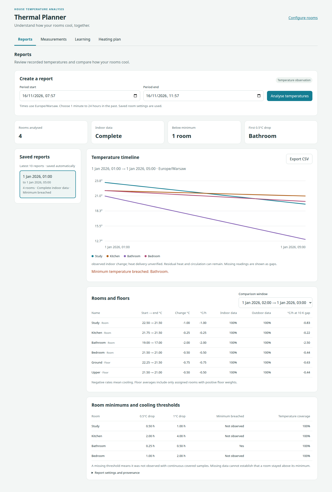

# Thermal Planner


Thermal Planner helps you understand how your home cools down and warms up. It runs inside Home Assistant and adds **Thermal Planner** to the sidebar.

Start by looking at your temperature history. Later, you can collect heating measurements, learn how each room behaves, and review suggested heating times. Automatic heating is optional and starts turned off.

You can use temperature reports with just room temperature sensors. Outdoor temperature, weather forecasts, humidity and energy readings add information when you have them. No MQTT setup is needed.



*Example report using simulated room data.*

## Install

<!-- ha-marketplace:exclude-start -->
### Marketplace or HACS

Repository: [ajmckee/warmy-warm](https://github.com/ajmckee/warmy-warm). The publication files are prepared; the GitHub release and shared catalog listing are still pending.

Once the repository contents and release are published, use this button to add the repository to your Home Assistant:

[](https://my.home-assistant.io/redirect/hacs_repository/?owner=ajmckee&repository=warmy-warm&category=integration)

On **Home Assistant 2026.11 or later**, install through **Settings → Marketplace** using the repository button above. On older supported releases, add `https://github.com/ajmckee/warmy-warm` in **HACS → Custom repositories** with type **Integration**, then install Thermal Planner. Restart Home Assistant if prompted, and after updates.

### Manual installation

1. Copy the `custom_components/thermal_planner` folder into your Home Assistant configuration folder, inside `custom_components`. The result should be `custom_components/thermal_planner/manifest.json`.
2. Restart Home Assistant.
<!-- ha-marketplace:exclude-end -->

## Set up Thermal Planner

Minimum supported Home Assistant: **2026.3.0**. The test workflow also checks **2026.11.0**. Installation on HAOS hardware and actual heating controls still need on-site checks.

[](https://my.home-assistant.io/redirect/config_flow_start/?domain=thermal_planner)

1. Open **Settings → Devices & services → Add integration** and search for **Thermal Planner**.
2. Choose an outdoor temperature sensor or an existing weather entity if you have one. You can continue without either. To add a weather provider, first add its integration in Home Assistant, then return to Thermal Planner.
3. Choose **Add room**, give it a name, and select its temperature sensor. Save the room, then repeat for your other rooms.
4. Choose **Save configuration**, then open **Thermal Planner** in the sidebar.

You do not need to write YAML or choose a heat pump to create temperature reports. Home Assistant must have recorded the selected sensors during the period you want to review.

## Find your way around

The dashboard has four tabs. **Reports** opens first.

| Tab | What you can do |
| --- | --- |
| **Reports** | Review past temperatures, compare rooms, and open saved reports. |
| **Measurements** | Record normal heating, run a controlled cooldown, or review completed measurements. |
| **Learning** | Build room predictions from measurements and see how well they work. |
| **Heating plan** | Compare normal heating with suggested timings using the weather forecast. |

Switching tabs keeps your current selections. You can bookmark a tab, for example `/thermal-planner#measurements`, and use your browser’s Back and Forward buttons.

Use **Configure rooms** at the top of the dashboard to change your setup. You can also reach it through **Settings → Devices & services → Thermal Planner → Configure**. Starting measurements and changing heating controls require a Home Assistant administrator account.

## Set up your rooms

Give each room a familiar name, such as **Living room**, **Kitchen** or **Bedroom**. Select the sensor that best represents the air temperature in that room.

- **More than one temperature sensor:** select them for the same room. By default, their readings are averaged equally. Advanced settings let you give one sensor more weight.
- **Floor:** choose an existing Home Assistant floor if useful. It is optional. Rooms without a floor still appear in reports.
- **Heating type:** choose radiators, underfloor heating (UFH), mixed, or other.
- **Circuit name:** an optional label for grouping rooms. It does not create a separate heating control.
- **Minimum temperature:** the lowest air temperature allowed during planner-controlled heating changes.
- **Comfort target:** the temperature you would like the room to reach. This is different from its minimum.

For example, a bedroom might have a comfort target of **20°C** and a minimum of **18°C**. These are examples, not recommended settings for every home. Choose values suitable for your household.

**Extra temperatures to record** are for comparison only. For example, you could record a floor-surface temperature beside the room’s air temperature. Extra readings do not change the room average or its minimum-temperature check.

The advanced **Include in comfort planning and first-room-to-cool result** setting decides whether the room’s comfort target shapes the plan and whether it takes part in the cooling comparison. Every room’s minimum still applies. A floor weight of zero leaves a room out of the floor average while keeping its own report and minimum check.

### Add another room later

Open **Configure → Manage rooms — add, edit or remove → Add another room**. Enter the room’s name and sensor, save the room, then choose **Save configuration**.

You can also edit or remove rooms there. Existing reports keep the settings used when they were created, so changing a room does not rewrite older results.

## Set up one heat pump with several rooms

Open **Configure → Heat pump and control bounds**. Name your heat pump and select its central Home Assistant climate entity if you want to run controlled measurements. Saving this configuration does not change the heating.

A **zone** is a part of the heating system served by the pump. It is different from a room, a floor, or a heating type.

For example:

| Room | Pump zone | Heating type |
| --- | --- | --- |
| Living room | Main zone | Underfloor heating |
| Kitchen | Main zone | Underfloor heating |
| Bedroom | Main zone | Radiators |

For this home, keep **one heat pump and one Main zone**. You do not need extra zones just because some rooms have radiators and others have UFH.

If your pump really has multiple zones, add them under **Heat pump zones**, then assign rooms to them. Optional zone readings help describe the system. This release controls the central heat pump; it does not independently operate zone thermostats or room valves. It supports one heat pump.

## Reports: understand a past period

1. Open **Reports**.
2. Choose a start and end time, from one minute to 24 hours in the past.
3. Select **Analyse temperatures**.
4. Review the graph, room results and data coverage.

For example, choose **01:00 to 05:00 last night** to see which rooms cooled fastest. The report shows each room’s temperature change and, when observed, how long it took to fall by 0.5°C or 1°C. If a room did not fall that far, the report says so.

A cooling rate of **−0.5°C per hour** means the room cooled by about half a degree per hour during that period. It does not prove the heating was off. Reports based only on temperatures describe what happened; they do not calculate how much energy each room used.

Check **data coverage** before comparing results. Gaps mean a reading was missing or too old to use. A blank result means there was not enough reliable data to calculate it. If readings are being marked old unexpectedly, review the freshness setting alongside how often your sensors report.

Outdoor readings help compare cooling in different weather. Without usable outdoor history, you still get indoor temperature results. A weather forecast cannot fill missing historical readings.

The latest ten reports are saved automatically. Open them from **Saved reports**. Use **Export CSV** only when you want a spreadsheet copy; downloading is not needed to read a report. Times use your Home Assistant time zone. If a clock-change time is skipped or occurs twice, choose a different period in the dashboard.

## Measurements: watch heating and recovery

There are two ways to collect measurements.

### Observe normal operation

Choose **Observe normal operation** on the **Measurements** tab and enter a duration, such as **120 minutes**.

This records what happens while your heating works as usual. It sends no heating commands and does not require commissioning. Stop any active scheduled control before starting it.

### Run a controlled cooldown

A controlled cooldown briefly pauses the selected heat pump, restores its previous settings, then watches the rooms warm up again. It requires source commissioning first.

1. Check your room minimums and the source’s pause limits in configuration.
2. On **Measurements**, choose the pause duration and select **Run once**.
3. Follow the status while it runs. Select **Stop / retry restore** to end it early.
4. When it finishes, select **View timeline** to review the cooldown and recovery.

Recovery means the rooms have returned close to their starting temperatures, within your configured tolerance. If the observation ends first, recovery is marked partial. Completed controlled measurements also create temperature reports.

A **campaign** repeats measurements on a schedule. Configure a local start time, target number of nights, end date and pause duration, then select **Start campaign**. A missed or unsafe night is skipped with a reason. It is not started late to catch up.

### Before controlling a real heat pump

First test with the [local simulator](dev/README.md). Then check the selected controls on your installation with someone present.

In the heat-pump settings, explicitly allow supervised commissioning. On **Measurements**, acknowledge the on-site check and start it. The integration checks that heating can be paused and that the original settings can be restored. Changing the source configuration requires commissioning again.

During controlled operation, a breached room minimum or missing required reading ends the test and starts restoration. After a Home Assistant restart, the integration checks for an interrupted operation and attempts restoration. Home Assistant cannot restore heating while it is offline. If restoration fails, the dashboard retains the failure and offers a retry. Manual heating changes take priority and cancel scheduled control.

## Learning: see what the measurements support

After collecting complete cooldown and recovery measurements, open **Learning** and select **Fit room models**.

The integration learns how each room responds to outdoor conditions and shared heating. UFH can continue releasing stored heat after the pump pauses, so it may behave differently from a radiator room.

Some measurements are kept aside to check the predictions. The displayed prediction error tells you how closely the predictions matched those separate measurements. For example, **0.2°C error** means they were typically about two tenths of a degree away from the measured temperature.

At least eight suitable measurements at the same water-temperature setting are needed before a model can qualify. More data does not guarantee a usable model: missing readings, unusual heating activity or inaccurate predictions can still prevent recommendations. The page explains when evidence is insufficient.

The learning demo is available only with the development fake house. Its results are labelled synthetic and cannot be used to control a real heat pump.

## Heating plan: review a suggestion first

Choose an existing Home Assistant weather entity in configuration. Then open **Heating plan** and select **Refresh forecast and plan**.

The page compares normal heating with a suggested plan. You can switch the graph between the two to compare expected room temperatures. Room minimums, comfort targets, forecast conditions and prediction uncertainty all affect whether a suggestion is available.

For example, a plan might suggest a short pause while the rooms are comfortably warm, followed by normal heating. If the evidence does not support a pause, the plan may keep normal heating or explain why no recommendation is available.

The three control choices are:

| Choice | What happens |
| --- | --- |
| **Advisory** | Shows a recommendation without changing heating. This is the default. |
| **Apply once** | Queues one qualified plan. Requires commissioned control. |
| **Enable Auto** | Allows the integration to refresh and apply qualified plans. Requires commissioned control. |

Use **Stop automatic planning** to cancel scheduled actions and restore any settings still owned by the planner. Automatic actions recheck current readings and forecasts before starting. Missing forecasts or insufficient evidence prevent new actions.

If the page compares heating on-time, treat that as a timing comparison. It is not a claim of electricity savings. Electrical energy estimates appear only when suitable measured energy data supports them.

### Optional water-temperature trials

The flow temperature is the temperature of the water sent to the heating system. Testing another setting requires an explicitly selected water-temperature control and feedback reading, confirmation of direct control, and safe minimum, maximum and change limits for your installation.

Do not copy limits from another home. If your climate entity’s target represents this same water temperature, select **Climate target mirrors this water-flow target**.

Approved trials help compare sustained water-temperature settings. One observed setting, or normal water-temperature fluctuations, is not enough to predict the effect of another setting. Heating-curve editing is not included.

## Optional humidity and energy readings

You can add these later without changing your temperature-only reports.

- **Humidity** adds humidity and dew-point information. Dew point is the temperature at which moisture could start condensing.
- **Comfort estimate** adds a rough warm/cool comfort assessment using stated assumptions, such as clothing and activity. It is advice; measured air temperature still controls minimum-temperature checks.
- **Electrical energy** is the electricity the pump consumes.
- **Thermal energy** is the heat it delivers.

Configure electrical and thermal readings separately and say what each reading includes. A reading that also includes domestic hot water is different from a space-heating-only reading. Missing data or a reset energy counter can make totals incomplete.

When compatible readings are available, the report can show COP: the heat delivered divided by electricity used. For example, **3 kWh of heat from 1 kWh of electricity gives COP 3**. This is different from the temperature change in a room.

With enough stable, measured heat-output data, Learning can also estimate whole-house heat demand. This does not divide energy use between individual rooms.

## Show a summary on your own dashboard

Thermal Planner exposes small summary sensors for status, the last report, data quality, planning mode and campaign progress. You can add these to your usual Home Assistant dashboard and open Thermal Planner for the full graphs.

An optional [dashboard card example](examples/dashboard.yaml) is provided. Adapt the entity names to match those in your Home Assistant installation.

## Try it on a laptop or contribute

The development lab uses a separate Home Assistant configuration and a simulated house. It needs no credentials for your live Home Assistant or MQTT broker.

From the repository folder, run:

```sh
sh dev/up.sh
```

Then open <http://127.0.0.1:8123>. See the [development guide](dev/README.md) for simulator setup, tests and restoration checks.

Automated simulator and browser checks do not replace checking your actual installation. Real heat-pump commissioning and a full walkthrough on your HAOS installation remain on-site tasks.

Maintainers: see [Publishing](docs/PUBLISHING.md) for release checks and catalog submission, and [Contributing](CONTRIBUTING.md) for development.

## License and support

Thermal Planner is maintained by [@ajmckee](https://github.com/ajmckee) and released under the [MIT license](LICENSE). Report problems in [GitHub Issues](https://github.com/ajmckee/warmy-warm/issues). Remove passwords, tokens and personal details before sharing logs.
